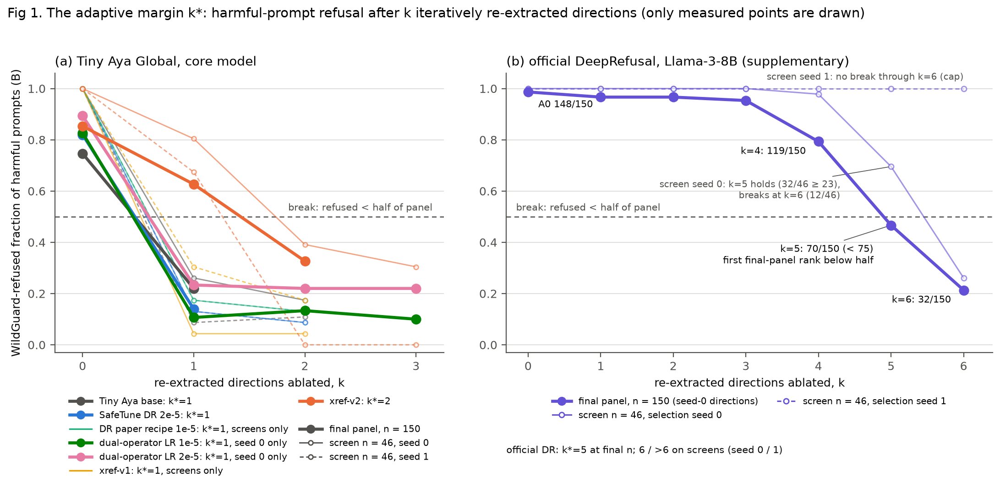

# Abliteration resistance is a finite margin

An adaptive audit of refusal-direction hardening on Cohere's Tiny Aya Global. The official Llama-3-8B DeepRefusal checkpoint is a supplementary reference. Read the [article](article.md) or the [static Space](https://huggingface.co/spaces/Observer04/abliteration-margin-audit).

- Our SafeTune DeepRefusal defense falls from 123/150 to 21/150 refusals after one re-extracted direction. Our two dual-operator doses also break at rank 1.
- The official DeepRefusal checkpoint first falls below half at rank 5: 70/150 refused. A layer-22 shift leaves 36/150 refused, against 146/150 for each matched random. GSM8K drops from 77 to 62/100.
- Hardening raises over-refusal from the Tiny Aya base's 61/350 to 110/350 for our SafeTune defense. Repair removes 109/350 over-refusals on official DeepRefusal, but spends margin on the weaker checkpoints.



Install the light dependencies to regenerate the four figures and check the reported counts:

```bash
python -m pip install -r requirements.txt
python figures/make_figures.py
python audit/reproduce_frozen.py
python -m pytest audit/tests -q
```

The [five result CSVs](results/) contain the reported final panels, screens, capability counts, paired tests and Wilson intervals. The [HF dataset](https://huggingface.co/datasets/Observer04/abliteration-margin-audit-evaluation) holds ID-only splits, source pins and a text rebuild tool. [Our three defense adapters](https://huggingface.co/Observer04/abliteration-margin-audit-t22) are failed defenses: [SafeTune](https://huggingface.co/Observer04/abliteration-margin-audit-t22), [dual-operator dose 1](https://huggingface.co/Observer04/abliteration-margin-audit-d11-dose1), [dose 2](https://huggingface.co/Observer04/abliteration-margin-audit-d11-dose2).

We withhold prompts, responses, per-prompt judgments, refusal vectors, abliterated weights and private research logs. They expose harmful content or make failed defenses easier to strip. The count tables support the figures without those artifacts. Statistics are shipped as computed tables. The paired tests cannot be recomputed without the withheld per-prompt judgments. [experiments/](experiments/) contains archived as-run GPU code. It needs the original payloads and GPU hosts. It is not a turnkey pipeline.

On a remote GPU host, install the archived experiment dependencies:

```bash
python -m pip install -r requirements-gpu.txt
```

See the [experiment README](experiments/README.md) for the archive limits.

Credit: StarWarrior24x7's concurrent [Heretic-Resistant Tiny Aya](https://huggingface.co/StarWarrior24x7/tiny-aya-global-xref-v2) provides the strongest Tiny Aya comparison. Its GSM8K drops from 178 to 116/250 under our steering audit. The [DeepRefusal authors](https://huggingface.co/skysys00/Meta-Llama-3-8B-Instruct-DeepRefusal) provide the supplementary checkpoint. CuratorKIT supplies provenance and deduplication, SafeTune supplies the defense baseline, and AuditKIT supplies the judge profiles and paired bootstrap. See the article for limits and attribution.

## Intended use and licenses

This release supports safety research and review of a negative defense result. The adapters are failed defenses and should not be treated as deployment safeguards. Loading one requires access to the gated Tiny Aya base. Each adapter card has a pinned loading example. Rebuilding the dataset retrieves harmful benchmark prompts.

Code uses Apache-2.0. The article, figures and our aggregate result tables use CC-BY-4.0. Tiny Aya adapters remain subject to CC-BY-NC-4.0 and Cohere's [Acceptable Use Addendum](https://cohere.com/cohere-labs-cc-by-nc-license) and [Acceptable Use Policy](https://docs.cohere.com/docs/cohere-labs-acceptable-use-policy). Upstream prompt rights are separate; see the dataset card and its pinned source records.

## Citation and contact

```bibtex
@misc{abliteration_margin_audit_2026,
  title = {Abliteration Resistance Is a Finite Margin},
  year = {2026},
  url = {https://github.com/Observer04/abliteration-margin-audit}
}
```

Report errors or ask reproducibility questions through [GitHub issues](https://github.com/Observer04/abliteration-margin-audit/issues).
